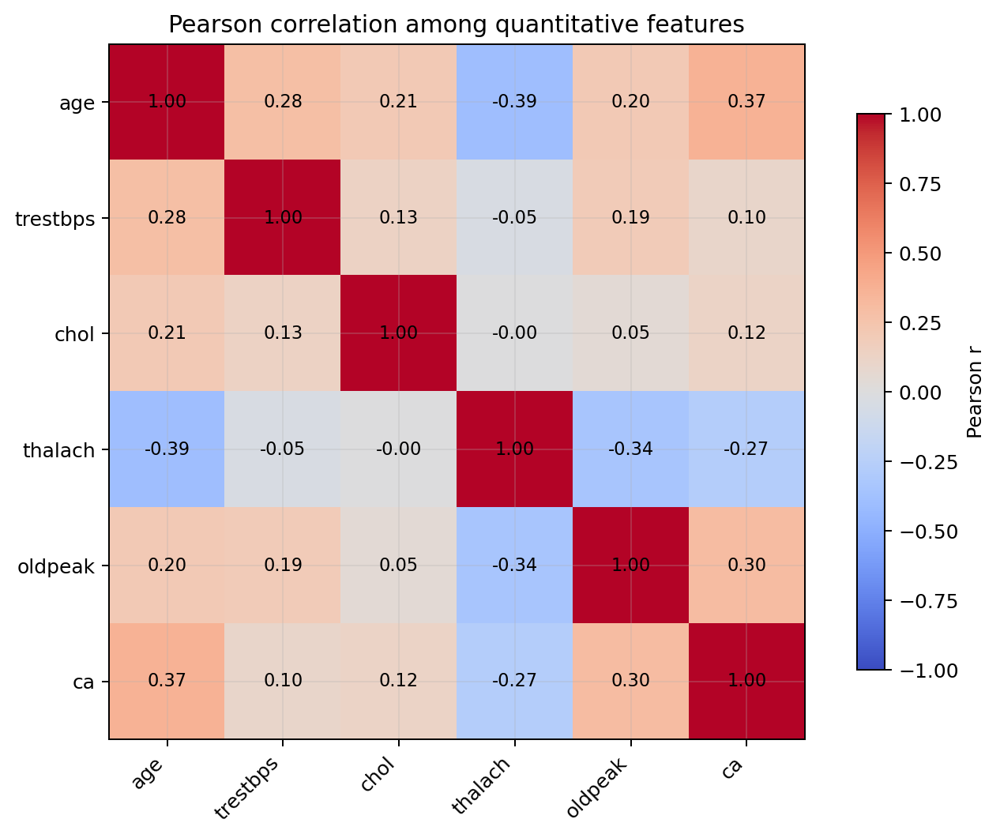
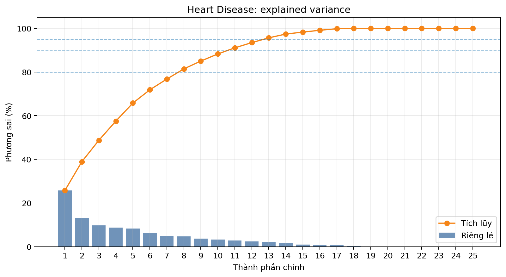
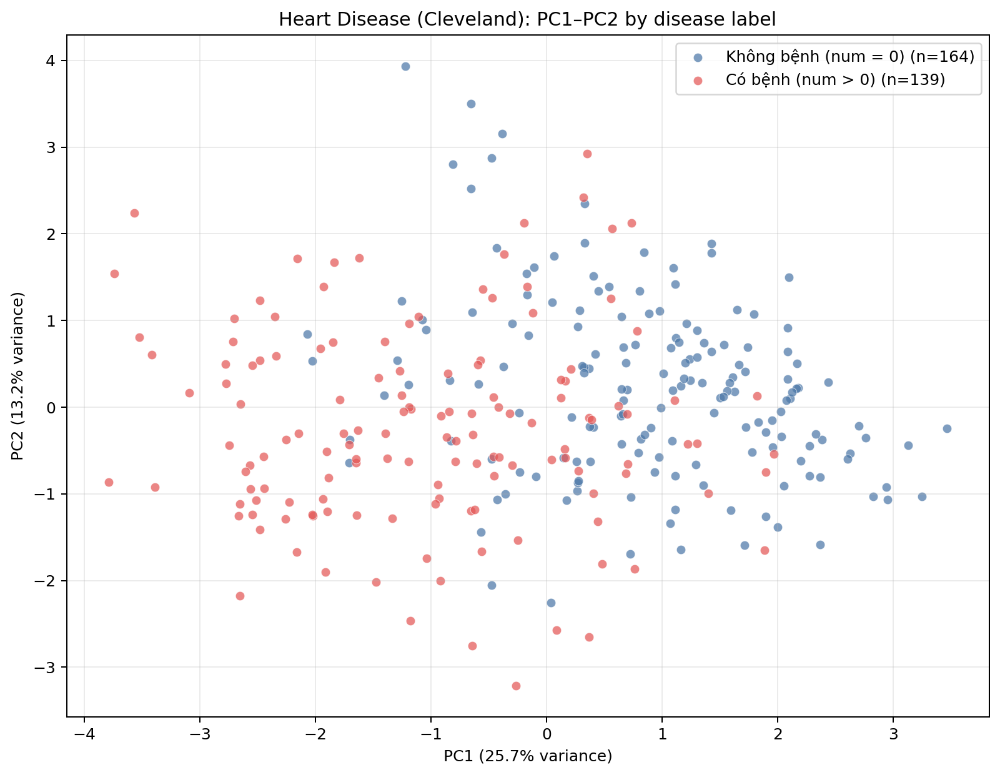

# Phân tích bộ dữ liệu Heart Disease (Cleveland)

**Phụ trách:** Nguyễn Hoàng Anh — **MSSV: 2410064**

> Phần này dùng kết quả thực tế từ `notebooks/02_heart_disease.ipynb` và tệp processed Cleveland của UCI. Bảng chi tiết có thể tái tạo từ các CSV Heart Disease trong `report/tables/`.

## 1. Mô tả dữ liệu và mục tiêu phân tích

Heart Disease là bộ dữ liệu y khoa đa biến của UCI Machine Learning Repository. Bản Cleveland được dùng trong bài này có 303 quan sát, 13 đặc trưng đầu vào và biến đích `num`. Theo mô tả UCI, `num` có các giá trị 0–4; các phân tích trên bản Cleveland thường gộp 1–4 thành nhóm có bệnh và so sánh với nhóm 0. UCI ghi nhận dữ liệu có giá trị thiếu. Bài toán phù hợp là phân loại, nhưng lab này tập trung vào chất lượng dữ liệu, thống kê mô tả và PCA, không yêu cầu huấn luyện bộ phân loại.

| Nội dung | Mô tả |
|---|---|
| Nguồn | [UCI Machine Learning Repository — Heart Disease](https://archive.ics.uci.edu/dataset/45/heart+disease) |
| Tập con | Cleveland, tệp `processed.cleveland.data` |
| Kích thước theo mô tả nguồn | 303 quan sát; 13 đặc trưng đầu vào |
| Biến gốc | 13 đầu vào và `num` (mức chẩn đoán 0–4) |
| Nhãn dùng để diễn giải | `disease_label = 0` nếu `num = 0`; `1` nếu `num > 0` |
| Bài toán phù hợp | Phân loại nhị phân hoặc đa lớp; PCA trong bài chỉ dùng để giảm chiều và trực quan hóa |

Không ghép các hàng Heart Disease với Wine Quality: hai bộ dữ liệu mô tả đối tượng và phép đo khác nhau, không có khóa chung để nối. Tích hợp rượu đỏ/trắng là thao tác riêng trong bộ Wine Quality; ở phần so sánh chung, hai bộ được đối chiếu qua kết quả phân tích và PCA.

## 2. Phân loại đặc trưng

Các mã số như `cp`, `restecg`, `slope` và `thal` biểu diễn nhóm/loại, không phải đại lượng có khoảng cách số học đồng đều. Vì vậy, chúng được xem là biến phân loại và one-hot encode trước PCA. `ca` là số lượng mạch lớn được quan sát bằng huỳnh quang, nên được giữ như một biến đếm định lượng và chuẩn hóa cùng các biến số khác.

| Biến | Ý nghĩa | Kiểu dữ liệu và thang đo | Vai trò | Xử lý cho PCA |
|---|---|---|---|---|
| `age` | Tuổi (năm) | Định lượng, số; liên tục về ý nghĩa, ghi theo số nguyên | Đầu vào | Chuẩn hóa |
| `sex` | Giới tính (0 = nữ, 1 = nam) | Định tính, phân loại nhị phân | Đầu vào | One-hot |
| `cp` | Loại đau ngực: 1 điển hình, 2 không điển hình, 3 không do đau thắt ngực, 4 không triệu chứng | Định tính, phân loại danh nghĩa | Đầu vào | One-hot |
| `trestbps` | Huyết áp lúc nghỉ (mm Hg) | Định lượng, số; liên tục | Đầu vào | Chuẩn hóa |
| `chol` | Cholesterol huyết thanh (mg/dl) | Định lượng, số; liên tục | Đầu vào | Chuẩn hóa |
| `fbs` | Đường huyết lúc đói > 120 mg/dl (0/1) | Định tính, phân loại nhị phân | Đầu vào | One-hot |
| `restecg` | ECG lúc nghỉ: 0 bình thường, 1 bất thường ST-T, 2 phì đại thất trái | Định tính, phân loại danh nghĩa | Đầu vào | One-hot |
| `thalach` | Nhịp tim tối đa đạt được | Định lượng, số; liên tục | Đầu vào | Chuẩn hóa |
| `exang` | Đau thắt ngực do gắng sức (0/1) | Định tính, phân loại nhị phân | Đầu vào | One-hot |
| `oldpeak` | ST depression do gắng sức so với lúc nghỉ | Định lượng, số; liên tục | Đầu vào | Chuẩn hóa |
| `slope` | Độ dốc ST: 1 đi lên, 2 phẳng, 3 đi xuống | Định tính, phân loại có thứ tự | Đầu vào | One-hot để không giả định khoảng cách tuyến tính |
| `ca` | Số mạch chính hiện màu khi soi huỳnh quang (0–3) | Định lượng rời rạc, biến đếm | Đầu vào | Chuẩn hóa |
| `thal` | Kết quả thal: 3 bình thường, 6 khuyết tật cố định, 7 khuyết tật có thể đảo ngược | Định tính, phân loại danh nghĩa | Đầu vào | One-hot |
| `num` | Mức chẩn đoán bệnh (0–4) | Nhãn thứ bậc, mã số phân loại | Mục tiêu | Không đưa vào PCA |

## 3. Chất lượng dữ liệu và làm sạch

Tệp có 303 hàng và 14 cột. Sáu ô thiếu xuất hiện ở `ca` (4) và `thal` (2); không có giá trị sai kiểu, sai miền hoặc hàng trùng hoàn toàn. Bốn giá trị thiếu `ca` được điền bằng trung vị 0; hai giá trị thiếu `thal` được điền bằng mode 3. Không có hàng nào bị loại, nên còn 303 hàng sau làm sạch. Các giá trị được kiểm tra theo miền mã của UCI; không tìm thấy giá trị ngoài miền.

Ngoại lệ được gắn cờ bằng quy tắc IQR trên các biến số, nhưng không tự động xóa. Một điểm nằm ngoài 1,5 IQR không nhất thiết là lỗi đo; xóa hàng có thể làm mất các trường hợp lâm sàng cực trị. Chỉ giá trị vi phạm quy tắc miền được xử lý như giá trị lỗi.

| Chỉ tiêu | Trước làm sạch | Sau làm sạch | Ghi chú |
|---|---:|---:|---|
| Số hàng | 303 | 303 | Không có hàng trùng hoặc thiếu nhãn |
| Số cột nguồn | 14 | 14 | Gồm 13 đầu vào và `num`; nhãn nhị phân phát sinh chỉ dùng để diễn giải |
| Ô thiếu (`?`/null) | 6 (`ca`: 4; `thal`: 2) | 0 | `ca`: trung vị 0; `thal`: mode 3 |
| Hàng trùng hoàn toàn | 0 | 0 | Không có hàng cần loại |
| Giá trị ngoài miền | 0 | 0 | Tất cả mã nằm trong miền kiểm tra |
| Hàng có ít nhất một ngoại lệ IQR | 35 | 35 | Cờ kiểm tra, không tự động xóa |

Theo IQR trên sáu biến số, `ca` có 20 cờ ngoại lệ, `trestbps` 9, `chol` 5, `oldpeak` 5 và `thalach` 1; `age` không có. Một hàng có thể bị gắn cờ ở nhiều cột. Riêng `ca = 3` vượt cận trên IQR là 2,5 nhưng vẫn thuộc miền hợp lệ 0–3 của biến này. Các điểm được gắn cờ đều được giữ vì không vi phạm miền hợp lệ; do đó làm sạch không thay đổi số mẫu.

## 4. Thống kê mô tả và phân tích biến phân loại

Notebook tính trung bình, phương sai mẫu, hiệp phương sai và Pearson correlation giữa `age`, `trestbps`, `chol`, `thalach`, `oldpeak`, `ca`. Pearson chỉ được diễn giải cho nhóm biến định lượng này; không tính tương quan Pearson trên các mã danh nghĩa như `cp` hoặc `thal`.

| Biến định lượng | Trung bình | Phương sai mẫu |
|---|---:|---:|
| `age` | 54,4389 | 81,6974 |
| `trestbps` | 131,6898 | 309,7511 |
| `chol` | 246,6931 | 2.680,8492 |
| `thalach` | 149,6073 | 523,2658 |
| `oldpeak` | 1,0396 | 1,3481 |
| `ca` | 0,6634 | 0,8731 |

Một vài phần tử ngoài đường chéo của ma trận hiệp phương sai mẫu:

| Cặp biến | Hiệp phương sai |
|---|---:|
| `age` – `thalach` | -81,4231 |
| `trestbps` – `chol` | 118,5733 |
| `oldpeak` – `ca` | 0,3266 |

| Kết quả cần báo cáo | Giá trị |
|---|---|
| Cặp có tương quan Pearson mạnh nhất theo trị tuyệt đối | `age` – `thalach` |
| Hệ số tương quan của cặp mạnh nhất | r = -0,3938 |
| Phân bố nhãn phân tích | Không bệnh: 164 (54,1%); có bệnh: 139 (45,9%) |

Tương quan âm mạnh nhất là `age`–`thalach` (r = -0,3938); tiếp theo là `age`–`ca` (r = 0,3653). Không cặp số nào có |r| ≥ 0,4, nên các liên hệ tuyến tính cặp đôi ở nhóm biến định lượng không mạnh trong mẫu này.

*Hình HD-1. Tương quan Pearson; đường chéo tự tương quan không được tính khi xếp hạng cặp mạnh nhất. Đánh số lại khi ghép báo cáo chung.*

Cramér's V hiệu chỉnh độ chệch và kiểm định chi-square giữa các biến phân loại với nhãn bệnh cho kết quả:

| Biến phân loại | Cramér's V | χ² (bậc tự do) | p-value |
|---|---:|---:|---:|
| `thal` | 0,5169 | 82,68 (2) | < 0,001 |
| `cp` | 0,5108 | 81,82 (3) | < 0,001 |
| `exang` | 0,4288 | 56,52 (1) | < 0,001 |
| `slope` | 0,3807 | 45,78 (2) | < 0,001 |
| `sex` | 0,2712 | 23,22 (1) | < 0,001 |
| `restecg` | 0,1632 | 10,05 (2) | 0,0066 |
| `fbs` | 0,0000 | 0,19 (1) | 0,6601 |

Trong mẫu này, `thal`, `cp` và `exang` có liên hệ phân loại mạnh nhất với nhãn bệnh theo Cramér's V. Ô kỳ vọng nhỏ nhất của bảng `restecg` là 1,83, dưới ngưỡng thường dùng 5, nên kết quả chi-square của biến này cần được xem thận trọng. Các kiểm định mang tính khám phá và không hàm ý nguyên nhân.

## 5. Tiền xử lý và phương pháp PCA

PCA nhạy với thang đo, nên sáu biến số được chuẩn hóa bằng z-score. Bảy biến phân loại được mã hóa one-hot để không tạo thứ tự giả giữa các mã danh nghĩa. One-hot columns được giữ ở thang 0/1; đây là lựa chọn có chủ đích để các biến liên tục có phương sai đơn vị sau chuẩn hóa, còn biến nhị phân/phân loại đóng góp theo tần suất nhóm. Báo cáo cần nêu rõ PCA vì thế áp dụng lên ma trận gồm các biến số chuẩn hóa và các cột one-hot, không phải 13 cột số nguyên chưa xử lý.

`num` và `disease_label` bị loại khỏi ma trận đầu vào PCA. PCA được tính bằng phân rã SVD trên ma trận đã tiền xử lý. Thành phần đầu giữ phương sai lớn nhất; các thành phần sau tối ưu phần phương sai còn lại dưới điều kiện trực giao. Số thành phần được xem xét ở k = 2, 3, 5 và theo các ngưỡng phương sai tích lũy 80%, 90%, 95%. So sánh này mô tả cấu trúc dữ liệu, không phải đánh giá hiệu năng dự đoán.

## 6. Kết quả PCA và trực quan hóa

Notebook tạo bảng phương sai giải thích cho tất cả 25 thành phần và lưu bản đầy đủ trong `report/tables/heart_pca_explained_variance.csv`. Các ngưỡng tích lũy và so sánh số thành phần là:

- Bảng phương sai giải thích riêng lẻ và tích lũy cho từng PC.
- Bảng số thành phần tối thiểu để đạt 80%, 90% và 95% phương sai tích lũy.
- Bảng so sánh k = 2, 3, 5 và các ngưỡng trên, kèm số chiều sau mã hóa, tỷ lệ phương sai giữ lại và sai số tái tạo.
- Scree plot và biểu đồ PC1–PC2 tô màu theo nhãn `không bệnh` / `có bệnh`.
- Bảng các đặc trưng có loading lớn nhất trên PC1 và PC2 để hỗ trợ diễn giải.

| Chỉ số | Kết quả |
|---|---:|
| Số cột sau mã hóa trước PCA | 25 |
| Phương sai tích lũy của PC1–PC2 | 38,93% |
| Số PC đạt ít nhất 80% | 8 (81,40%) |
| Số PC đạt ít nhất 90% | 11 (91,06%) |
| Số PC đạt ít nhất 95% | 13 (95,63%) |

| Thành phần | Riêng lẻ (%) | Tích lũy (%) | Thành phần | Riêng lẻ (%) | Tích lũy (%) |
|---|---:|---:|---|---:|---:|
| PC1 | 25,71 | 25,71 | PC10 | 3,25 | 88,25 |
| PC2 | 13,22 | 38,93 | PC11 | 2,81 | 91,06 |
| PC3 | 9,79 | 48,72 | PC12 | 2,39 | 93,45 |
| PC4 | 8,79 | 57,50 | PC13 | 2,18 | 95,63 |
| PC5 | 8,24 | 65,75 | PC14 | 1,75 | 97,38 |
| PC6 | 6,09 | 71,84 | PC15 | 0,89 | 98,26 |
| PC7 | 4,92 | 76,76 | PC16 | 0,83 | 99,10 |
| PC8 | 4,64 | 81,40 | PC17 | 0,71 | 99,81 |
| PC9 | 3,61 | 85,00 | PC18 | 0,19 | 100,00 |

PC1 giải thích nhiều nhất (25,71%). PC18 là thành phần cuối cùng có phương sai dương đáng kể (0,19%); PC19–PC25 có phương sai xấp xỉ 0. Bảy thành phần bằng 0 xuất hiện do giữ toàn bộ mức của bảy biến phân loại one-hot, tạo các quan hệ tuyến tính phụ thuộc giữa chỉ báo trong cùng một biến. Chúng không mang thêm thông tin, nên bảng loading chỉ lưu PC1–PC18; loading của không gian phương sai bằng 0 không ổn định và không có ý nghĩa diễn giải duy nhất. Với các thành phần có phương sai dương, phương sai thấp tự nó không chứng minh rằng một thành phần vô ích cho dự đoán; PCA không tối ưu quan hệ với nhãn.

| Số thành phần k | Phương sai giữ lại | Số chiều giảm | MSE tái tạo |
|---:|---:|---:|---:|
| 2 | 38,93% | 23/25 (92%) | 0,2297 |
| 3 | 48,72% | 22/25 (88%) | 0,1929 |
| 5 | 65,75% | 20/25 (80%) | 0,1288 |
| 8 | 81,40% | 17/25 (68%) | 0,0700 |
| 11 | 91,06% | 14/25 (56%) | 0,0336 |
| 13 | 95,63% | 12/25 (48%) | 0,0164 |

Hai thành phần cho biểu đồ gọn nhất nhưng chỉ giữ 38,93% phương sai. Tám thành phần là lựa chọn tối thiểu đạt ngưỡng 80%; 11 và 13 thành phần lần lượt vượt 90% và 95%. Tỷ lệ giảm chiều trong bảng được tính so với 25 cột sau mã hóa, không phải 13 đặc trưng nguồn. Sai số tái tạo giảm khi tăng k, đổi lại số chiều được loại bỏ ít hơn. MSE được tính trong ma trận sau chuẩn hóa/mã hóa.

Theo trị tuyệt đối của loading, PC1 liên hệ mạnh nhất với `thalach` (+0,451), `oldpeak` (-0,434), `age` (-0,425) và `ca` (-0,403). PC2 chủ yếu liên hệ với `chol` (+0,606), `trestbps` (+0,460), `age` (+0,323), `thalach` (+0,299) và `oldpeak` (-0,240). Dấu của trục có thể đảo; diễn giải tập trung vào các biến đóng góp lớn và hướng tương đối.

*Hình HD-2. Scree plot. Các thành phần PC19–PC25 có phương sai bằng 0 do dư thừa tuyến tính trong one-hot encoding. Đánh số lại khi ghép báo cáo chung.*

*Hình HD-3. PC1–PC2 giữ 38,93% phương sai của ma trận đã tiền xử lý. Đánh số lại khi ghép báo cáo chung.*

Trên hình PC1–PC2, nhóm không bệnh tập trung nhiều hơn về phía PC1 dương; nhóm có bệnh xuất hiện nhiều hơn ở phía PC1 âm. Hai nhóm vẫn chồng lấn đáng kể quanh vùng PC1 gần 0, nên phép chiếu hai chiều không tách hoàn toàn nhãn. Một số điểm nằm xa đám mây trung tâm; chúng được giữ vì các giá trị gốc nằm trong miền kiểm tra. Biểu đồ không phải kết quả của một mô hình phân loại.

Khi diễn giải, cần lưu ý PCA tối đa hóa phương sai chứ không tối ưu phân tách nhãn bệnh. Nếu hai màu chồng lấn trên PC1–PC2, điều đó chỉ nói rằng phép chiếu hai chiều không tách rõ nhóm; không chứng minh rằng dữ liệu không chứa thông tin liên quan đến nhãn. Dấu của mỗi PC có thể đảo mà không làm thay đổi nghiệm.

## 7. Kết luận và giới hạn

Sau khi điền các giá trị thiếu bằng trung vị/mode và giữ lại các điểm IQR hợp lệ, còn nguyên 303 quan sát. Tương quan tuyến tính mạnh nhất giữa các biến số là âm vừa phải giữa tuổi và nhịp tim tối đa; các liên hệ phân loại lớn nhất với nhãn bệnh trong mẫu thuộc về thal và cp. Trên 25 cột sau one-hot, PC1–PC2 giữ 38,93%; 8 PC đạt 81,40%, còn 13 PC đạt 95,63%. Vì vậy, số PC phù hợp phụ thuộc mục đích: 2 PC hỗ trợ trực quan hóa, còn 8–13 PC giữ phần lớn phương sai hơn.

Giới hạn gồm kích thước nhỏ và tính đại diện hạn chế của Cleveland, việc điền giá trị thiếu có thể làm giảm biến thiên, cách mã hóa one-hot ảnh hưởng khoảng cách trong PCA, và độ nhạy của PCA với ngoại lệ. PCA tối ưu phương sai tổng thể chứ không tối ưu dự đoán `num`; đây là phân tích học thuật trên dữ liệu công khai, không phải kết luận lâm sàng.

## Tài liệu tham khảo

Janosi, A., Steinbrunn, W., Pfisterer, M., & Detrano, R. (1989). *Heart Disease* [Dataset]. UCI Machine Learning Repository. [https://doi.org/10.24432/C52P4X](https://doi.org/10.24432/C52P4X). Dữ liệu: [UCI Heart Disease](https://archive.ics.uci.edu/dataset/45/heart+disease).

## Tài liệu tái lập

Phân tích, bảng và hình trong phần này được tạo bởi [`../notebooks/02_heart_disease.ipynb`](../notebooks/02_heart_disease.ipynb). Hình đầu ra có tiền tố `heart_` trong `report/figures/`; bảng đầu ra có tiền tố `heart_` trong `report/tables/`.
