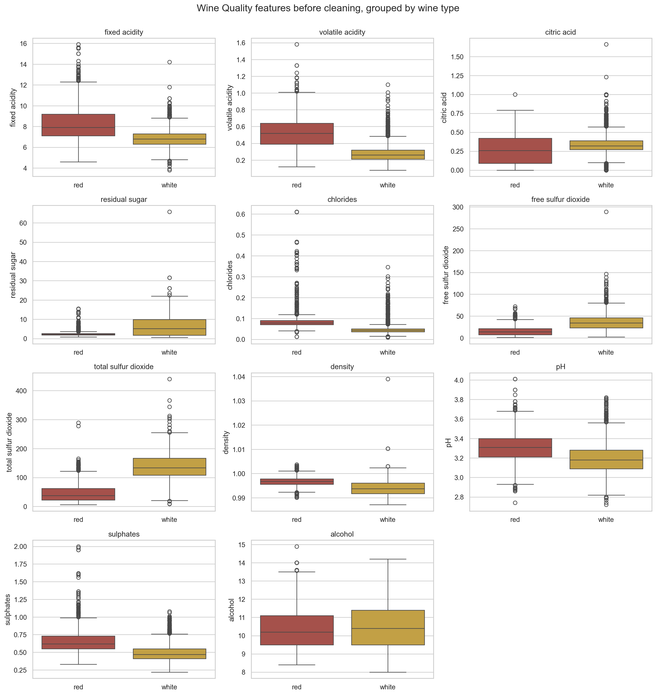
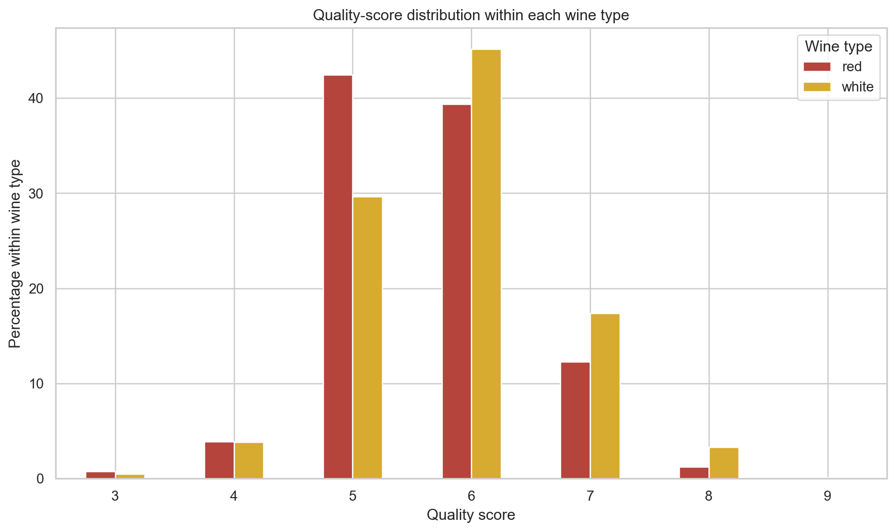
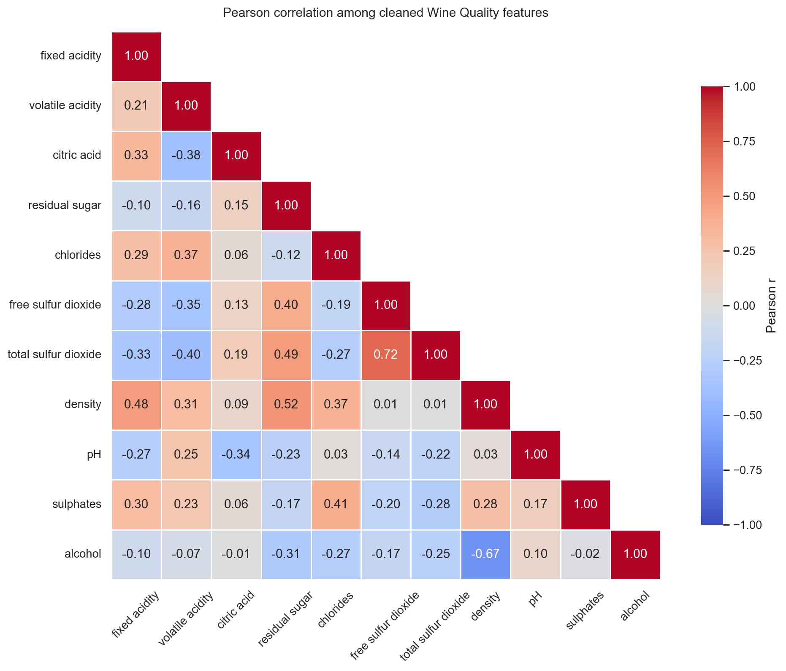
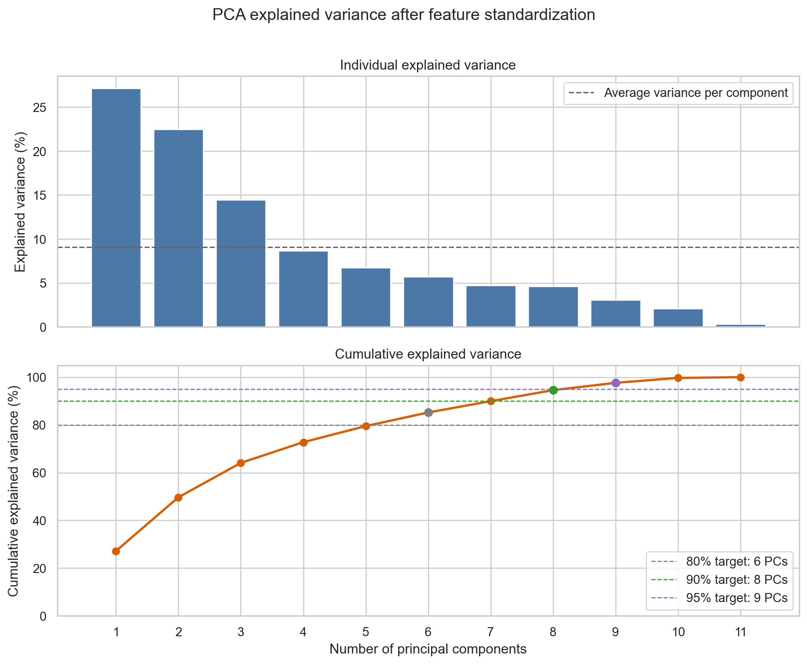
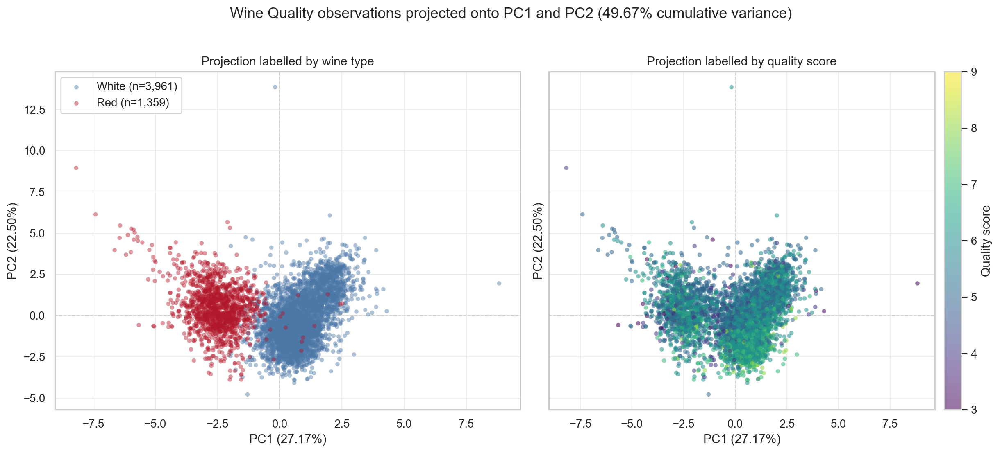
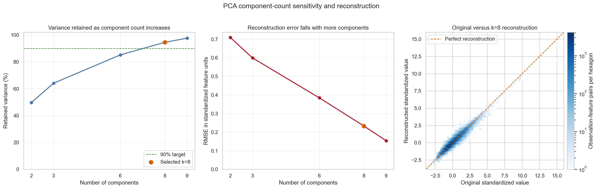

# Phân tích bộ dữ liệu Wine Quality

**Phụ trách:** Nguyễn Hoàng Minh — **MSSV: [CẦN BỔ SUNG]**

## 1. Mô tả dữ liệu và mục tiêu phân tích

Bộ dữ liệu Wine Quality do UCI Machine Learning Repository công bố, gồm hai tệp mô tả rượu Vinho Verde đỏ và trắng của Bồ Đào Nha. Mỗi mẫu có 11 phép đo hóa lý và một điểm `quality` do đánh giá cảm quan. Theo UCI, dữ liệu có thể được sử dụng cho bài toán hồi quy hoặc phân loại chất lượng; các lớp chất lượng có thứ tự và mất cân bằng [1].

| Nội dung | Giá trị |
|---|---:|
| Số mẫu rượu đỏ ban đầu | 1.599 |
| Số mẫu rượu trắng ban đầu | 4.898 |
| Tổng số mẫu sau tích hợp, trước làm sạch | 6.497 |
| Số đặc trưng hóa lý | 11 |
| Biến mục tiêu | `quality`, điểm thứ bậc từ 0 đến 10 theo mô tả nguồn |
| Nhãn bổ sung khi tích hợp | `wine_type`, gồm `red` và `white` |
| Bài toán học máy phù hợp | Hồi quy điểm chất lượng hoặc phân loại thứ bậc |

Trong bài thực hành này, PCA chỉ được khớp trên 11 đặc trưng hóa lý. `quality` được giữ lại làm biến mục tiêu để diễn giải, còn `wine_type` được dùng làm nhãn nhóm trên biểu đồ. Hai biến này không tham gia tính các thành phần chính.

## 2. Phân loại đặc trưng và tích hợp dữ liệu

| Biến | Vai trò | Liên tục/rời rạc | Định lượng/định tính | Dùng khớp PCA |
|---|---|---|---|---|
| `fixed acidity` | Đầu vào | Liên tục | Định lượng, số | Có |
| `volatile acidity` | Đầu vào | Liên tục | Định lượng, số | Có |
| `citric acid` | Đầu vào | Liên tục | Định lượng, số | Có |
| `residual sugar` | Đầu vào | Liên tục | Định lượng, số | Có |
| `chlorides` | Đầu vào | Liên tục | Định lượng, số | Có |
| `free sulfur dioxide` | Đầu vào | Liên tục | Định lượng, số | Có |
| `total sulfur dioxide` | Đầu vào | Liên tục | Định lượng, số | Có |
| `density` | Đầu vào | Liên tục | Định lượng, số | Có |
| `pH` | Đầu vào | Liên tục | Định lượng, số | Có |
| `sulphates` | Đầu vào | Liên tục | Định lượng, số | Có |
| `alcohol` | Đầu vào | Liên tục | Định lượng, số | Có |
| `quality` | Mục tiêu | Rời rạc, có thứ tự | Định lượng/thứ bậc | Không |
| `wine_type` | Nhãn tích hợp | Rời rạc, định danh | Định tính/phân loại | Không |

Hai tệp nguồn đều dùng dấu chấm phẩy làm ký tự phân cách và có cùng 12 cột ban đầu. Vì vậy, nhóm thêm cột `wine_type` vào từng tệp rồi nối các hàng. Cột mới bảo toàn nguồn gốc đỏ/trắng của mỗi mẫu, cho phép phân tích theo nhóm và tránh mất thông tin sau tích hợp.

Khó khăn chính không nằm ở sự khác biệt lược đồ mà ở sự khác biệt phân phối giữa hai loại rượu. Nếu tính ngoại lệ hoặc tương quan trên toàn bộ dữ liệu mà không xem xét `wine_type`, kết quả có thể phản ánh cấu trúc hỗn hợp giữa hai nhóm. Do đó, ngoại lệ IQR được kiểm tra cả toàn cục và trong từng loại rượu; tương quan mạnh nhất cũng được báo cáo cho toàn bộ dữ liệu, rượu đỏ và rượu trắng riêng biệt.

## 3. Chất lượng dữ liệu và làm sạch

Quá trình kiểm tra không phát hiện giá trị thiếu, giá trị vô hạn hoặc vi phạm các quy tắc hợp lệ cơ bản. Vấn đề chính là 1.177 hàng trùng lặp hoàn toàn trong cùng `wine_type`. Các hàng này được loại bỏ và chỉ giữ lần xuất hiện đầu tiên, vì giữ bản sao sẽ làm một số mẫu nhận trọng số lớn hơn không có căn cứ trong thống kê, tương quan và PCA.

| Chỉ tiêu | Trước làm sạch | Sau làm sạch | Thay đổi |
|---|---:|---:|---:|
| Số hàng | 6.497 | 5.320 | -1.177 |
| Số cột | 13 | 13 | 0 |
| Ô bị thiếu | 0 | 0 | 0 |
| Ô số vô hạn | 0 | 0 | 0 |
| Số hàng trùng dư | 1.177 | 0 | -1.177 |
| Vi phạm quy tắc hợp lệ | 0 | 0 | 0 |
| Hàng có ít nhất một ngoại lệ IQR theo loại rượu | 1.288 | 1.046 | -242 |
| Tỷ lệ hàng ngoại lệ IQR theo loại rượu | 19,82% | 19,66% | -0,16 điểm % |

Sau loại trùng, dữ liệu gồm 1.359 mẫu đỏ và 3.961 mẫu trắng. Các ngoại lệ IQR không bị xóa vì chúng xuất hiện khá thường xuyên, vẫn thỏa mãn quy tắc hợp lệ và có thể là biến thiên hóa lý thực. Việc loại toàn bộ 1.046 hàng bị gắn cờ sau làm sạch sẽ xóa gần 20% dữ liệu và có nguy cơ làm mất các mẫu rượu hiếm. Thay vào đó, trạng thái ngoại lệ được lưu riêng để đảm bảo minh bạch.

*Hình 1. Boxplot trước làm sạch cho thấy nhiều đặc trưng lệch và có giá trị cực trị. Cờ IQR được dùng để chẩn đoán, không được xem tự động là lỗi đo.*

Phân bố nhóm không cân bằng: rượu trắng chiếm 74,45%, rượu đỏ chiếm 25,55%. Điểm chất lượng cũng tập trung mạnh ở mức 5 và 6, lần lượt chiếm 32,93% và 43,67%; chỉ có 5 mẫu đạt điểm 9. Sự mất cân bằng này cần được lưu ý khi diễn giải biểu đồ theo nhãn.

*Hình 2. Phân bố `quality` theo `wine_type`; các mức chất lượng rất thấp hoặc rất cao có ít quan sát.*

## 4. Thống kê mô tả, hiệp phương sai và biến phân loại

Thống kê sau đây được tính trên 5.320 mẫu đã làm sạch. Phương sai là phương sai mẫu (`ddof = 1`).

| Đặc trưng | Trung bình | Phương sai mẫu | Trung vị | Nhỏ nhất | Lớn nhất |
|---|---:|---:|---:|---:|---:|
| Fixed acidity | 7,2152 | 1,7415 | 7,0000 | 3,8000 | 15,9000 |
| Volatile acidity | 0,3441 | 0,0283 | 0,3000 | 0,0800 | 1,5800 |
| Citric acid | 0,3185 | 0,0217 | 0,3100 | 0,0000 | 1,6600 |
| Residual sugar | 5,0485 | 20,2516 | 2,7000 | 0,6000 | 65,8000 |
| Chlorides | 0,0567 | 0,0014 | 0,0470 | 0,0090 | 0,6110 |
| Free sulfur dioxide | 30,0367 | 317,0196 | 28,0000 | 1,0000 | 289,0000 |
| Total sulfur dioxide | 114,1090 | 3.223,3124 | 116,0000 | 6,0000 | 440,0000 |
| Density | 0,9945 | 0,000009 | 0,99465 | 0,98711 | 1,03898 |
| pH | 3,2247 | 0,0257 | 3,2100 | 2,7200 | 4,0100 |
| Sulphates | 0,5334 | 0,0224 | 0,5100 | 0,2200 | 2,0000 |
| Alcohol | 10,5492 | 1,4064 | 10,4000 | 8,0000 | 14,9000 |

Ma trận hiệp phương sai đầy đủ được tính cho 11 biến. Hiệp phương sai ngoài đường chéo có độ lớn lớn nhất là giữa `free sulfur dioxide` và `total sulfur dioxide`, bằng 728,3184. Tuy nhiên, độ lớn hiệp phương sai phụ thuộc đơn vị đo: các biến sulfur dioxide có phương sai lớn hơn nhiều so với `density`, `pH` hoặc `chlorides`. Vì vậy, hiệp phương sai phù hợp để mô tả biến thiên chung trên thang đo gốc, nhưng hệ số tương quan và PCA sau chuẩn hóa phù hợp hơn khi so sánh mức liên hệ giữa các đặc trưng khác đơn vị.

Đối với hai biến phân loại/thứ bậc, bảng chéo `wine_type × quality` cho kết quả kiểm định Chi-square là 92,4624 với 6 bậc tự do và p = 9,33 × 10⁻¹⁸. Giả thuyết độc lập bị bác bỏ, nhưng Cramér's V hiệu chỉnh chỉ bằng 0,1275, cho thấy mức liên hệ yếu. Có 2 trong 14 ô kỳ vọng dưới 5 và giá trị kỳ vọng nhỏ nhất là 1,277; do đó kết luận cần thận trọng vì các mức chất lượng hiếm làm suy yếu xấp xỉ Chi-square. Kiểm định này cũng coi `quality` là các nhóm phân loại và không sử dụng thứ tự tự nhiên của điểm số.

## 5. Phân tích tương quan

Tương quan Pearson được tính cho 11 đặc trưng hóa lý liên tục. Đường chéo tự tương quan được loại trước khi xếp hạng.

| Phạm vi | Cỡ mẫu | Cặp đặc trưng mạnh nhất | Pearson r | Trị tuyệt đối của r |
|---|---:|---|---:|---:|
| Toàn bộ dữ liệu | 5.320 | Free sulfur dioxide – Total sulfur dioxide | 0,7205 | 0,7205 |
| Rượu đỏ | 1.359 | Fixed acidity – pH | -0,6867 | 0,6867 |
| Rượu trắng | 3.961 | Residual sugar – Density | 0,8205 | 0,8205 |

*Hình 3. Ma trận tương quan Pearson của 11 đặc trưng hóa lý. `quality` và `wine_type` không nằm trong ma trận này.*

Trên toàn bộ dữ liệu, `free sulfur dioxide` và `total sulfur dioxide` có tương quan dương mạnh nhất (r = 0,7205), phù hợp với việc tổng sulfur dioxide bao gồm phần tự do và phần liên kết. Tương quan âm mạnh nhất là giữa `density` và `alcohol` (r = -0,6678). Kết quả theo từng loại rượu khác với kết quả gộp, chứng minh rằng tích hợp dữ liệu có thể làm thay đổi cấu trúc tương quan quan sát được. Tương quan chỉ mô tả quan hệ tuyến tính và không chứng minh quan hệ nhân quả.

## 6. Tiền xử lý và phương pháp PCA

Các đặc trưng có đơn vị và độ phân tán rất khác nhau. Ví dụ, phương sai của `total sulfur dioxide` là 3.223,3124 trong khi phương sai của `density` chỉ khoảng 0,000009. Nếu PCA trực tiếp trên ma trận hiệp phương sai gốc, các biến có thang đo lớn sẽ chi phối kết quả. Vì vậy, mỗi đặc trưng được chuẩn hóa bằng

\[
z_{ij}=\frac{x_{ij}-\mu_j}{\sigma_j},
\]

trong đó `StandardScaler` sử dụng độ lệch chuẩn tổng thể. Sau biến đổi, trị tuyệt đối trung bình lớn nhất giữa 11 cột nhỏ hơn 1,86 × 10⁻¹⁴, và sai lệch lớn nhất của độ lệch chuẩn tổng thể so với 1 là 2,22 × 10⁻¹⁶. `quality` và `wine_type` không được đưa vào scaler hoặc PCA.

PCA được khớp bằng SVD đầy đủ trên ma trận chuẩn hóa. Mỗi thành phần chính là một tổ hợp tuyến tính trực giao của 11 đặc trưng. Thành phần đầu tiên tối đa hóa phương sai của điểm chiếu; các thành phần sau tối đa hóa phần phương sai còn lại dưới ràng buộc trực giao. Số thành phần chính được chọn theo tỷ lệ phương sai tích lũy, với ngưỡng chính là 90%; ngưỡng 80% và 95% được dùng để phân tích độ nhạy.

## 7. Phương sai giải thích và diễn giải thành phần

| Thành phần | Giá trị riêng | Phương sai giải thích | Phương sai tích lũy |
|---|---:|---:|---:|
| PC1 | 2,9889 | 27,17% | 27,17% |
| PC2 | 2,4757 | 22,50% | 49,67% |
| PC3 | 1,5876 | 14,43% | 64,10% |
| PC4 | 0,9536 | 8,67% | 72,77% |
| PC5 | 0,7424 | 6,75% | 79,51% |
| PC6 | 0,6272 | 5,70% | 85,21% |
| PC7 | 0,5211 | 4,74% | 89,95% |
| PC8 | 0,5077 | 4,61% | 94,57% |
| PC9 | 0,3368 | 3,06% | 97,63% |
| PC10 | 0,2260 | 2,05% | 99,68% |
| PC11 | 0,0351 | 0,32% | 100,00% |

*Hình 4. Phương sai riêng lẻ và tích lũy sau khi chuẩn hóa 11 đặc trưng.*

PC1, PC2 và PC3 có phương sai lớn nhất và đều có giá trị riêng lớn hơn 1; ba thành phần này giữ 64,10% tổng phương sai. Ngược lại, PC11 chỉ giữ 0,32%, cho thấy một hướng gần dư thừa trong không gian đặc trưng. Tuy nhiên, phương sai thấp không đồng nghĩa thành phần chắc chắn vô ích cho một bài toán dự đoán, vì PCA tối ưu phương sai chứ không tối ưu quan hệ với mục tiêu.

| Ngưỡng phương sai | Số thành phần tối thiểu | Phương sai thực tế giữ lại |
|---:|---:|---:|
| 80% | 6 | 85,21% |
| 90% | 8 | 94,57% |
| 95% | 9 | 97,63% |

Theo correlation loading, PC1 liên hệ mạnh nhất với `total sulfur dioxide` (+0,823), `free sulfur dioxide` (+0,736) và `volatile acidity` (-0,674). Điểm PC1 cao mô tả các mẫu có sulfur dioxide cao hơn nhưng volatile acidity, chlorides và sulphates thấp hơn trong nghiệm PCA hiện tại. PC2 chủ yếu đối lập `density` (+0,889) và `residual sugar` (+0,579) với `alcohol` (-0,732); điểm PC2 cao tương ứng với rượu đặc hơn, ngọt hơn và có độ cồn thấp hơn. Dấu của một trục PCA có thể đảo mà không thay đổi nghiệm, nên phần diễn giải tập trung vào độ lớn tương đối và quan hệ giữa các dấu.

## 8. Trực quan hóa PC1–PC2

*Hình 5. Phép chiếu lên PC1 và PC2, tô màu lần lượt theo `wine_type` và `quality`. Hai trục giữ tổng cộng 49,67% phương sai chuẩn hóa.*

Rượu đỏ tập trung chủ yếu ở phía PC1 âm, còn phần lớn rượu trắng nằm gần 0 hoặc phía PC1 dương. Hai nhóm vẫn chồng lấn tại ranh giới nên PC1–PC2 không tách hoàn toàn loại rượu. Các màu chất lượng chồng lấn mạnh và không tạo cụm rõ ràng, cho thấy hai thành phần đầu chưa đủ để phân biệt điểm cảm quan. Các điểm có tọa độ cực trị được giữ trên hình vì các quan sát tương ứng đã vượt qua kiểm tra hợp lệ. Ngoài ra, biểu đồ hai chiều chỉ giữ 49,67% phương sai, nên không thể đại diện đầy đủ cấu trúc 11 chiều.

## 9. Số thành phần, tái tạo dữ liệu và lựa chọn mô hình

Các mô hình PCA được khớp lại với nhiều số thành phần. Điểm PCA sau giảm chiều được biến đổi ngược về không gian 11 đặc trưng đã chuẩn hóa để đo sai số tái tạo.

| Số thành phần | Phương sai giữ lại | Giảm số chiều | MSE tái tạo | RMSE tái tạo |
|---:|---:|---:|---:|---:|
| 2 | 49,67% | 81,82% | 0,5033 | 0,7094 |
| 3 | 64,10% | 72,73% | 0,3590 | 0,5992 |
| 6 | 85,21% | 45,45% | 0,1479 | 0,3845 |
| **8** | **94,57%** | **27,27%** | **0,0543** | **0,2331** |
| 9 | 97,63% | 18,18% | 0,0237 | 0,1540 |

*Hình 6. Phương sai giữ lại, RMSE tái tạo và so sánh trực tiếp giá trị chuẩn hóa gốc với bản tái tạo khi k = 8.*

Hai hoặc ba thành phần rất gọn cho trực quan hóa nhưng lần lượt làm mất 50,33% và 35,90% phương sai. Sáu thành phần giữ 85,21%, chưa đạt ngưỡng 90%. Tám thành phần là cấu hình nhỏ nhất trong các cấu hình được thử vượt ngưỡng chính, giữ 94,57% phương sai và giảm RMSE xuống 0,2331 đơn vị chuẩn hóa. Thành phần thứ chín tăng phương sai giữ lại thêm 3,06 điểm phần trăm nhưng giảm lợi ích giảm chiều. Vì vậy, k = 8 được chọn làm biểu diễn giảm chiều chính.

Với k = 8, sai số RMSE theo biến lớn nhất thuộc về `total sulfur dioxide` (0,390), `free sulfur dioxide` (0,314) và `volatile acidity` (0,299). So sánh này được thực hiện trong không gian chuẩn hóa; nếu cần giá trị theo đơn vị gốc, phải áp dụng thêm phép biến đổi ngược của scaler.

## 10. Kết luận và hạn chế

Quy trình đã tích hợp hai tệp rượu đỏ và trắng, loại 1.177 bản ghi trùng, giữ lại các giá trị cực trị hợp lệ và chuẩn hóa 11 đặc trưng trước PCA. Sau làm sạch còn 5.320 mẫu. Cấu trúc tương quan thay đổi theo loại rượu, vì vậy nhãn `wine_type` là cần thiết để tránh diễn giải sai kết quả gộp. PCA cho thấy ba thành phần đầu giữ 64,10% phương sai, còn tám thành phần giữ 94,57% và tạo cân bằng phù hợp giữa bảo toàn thông tin và giảm chiều.

Các hạn chế chính gồm: PCA chỉ mô tả quan hệ tuyến tính; kết quả nhạy với ngoại lệ và cách chuẩn hóa; phương sai lớn không đảm bảo giá trị dự đoán đối với `quality`; lớp chất lượng và loại rượu không cân bằng; và biểu đồ PC1–PC2 chỉ giữ gần một nửa tổng phương sai. Phân tích này mang tính mô tả trên toàn bộ dữ liệu. Nếu xây dựng mô hình dự đoán, scaler và PCA phải được khớp riêng trên tập huấn luyện để tránh rò rỉ dữ liệu.

## Tài liệu tham khảo

[1] P. Cortez, A. Cerdeira, F. Almeida, T. Matos, và J. Reis, “Wine Quality,” UCI Machine Learning Repository, 2009. DOI: [10.24432/C56S3T](https://doi.org/10.24432/C56S3T). Trang dữ liệu: [UCI Wine Quality](https://archive.ics.uci.edu/dataset/186/wine+quality).

[2] P. Cortez, A. Cerdeira, F. Almeida, T. Matos, và J. Reis, “Modeling wine preferences by data mining from physicochemical properties,” *Decision Support Systems*, 2009. Tài liệu và dữ liệu liên quan: [University of Minho Wine Quality](http://www3.dsi.uminho.pt/pcortez/wine/).

## Tài liệu tái lập

Toàn bộ số liệu, kiểm tra và hình trong phần này được tạo từ [`../notebooks/01_wine_quality.ipynb`](../notebooks/01_wine_quality.ipynb). Các bảng chi tiết nằm trong thư mục [`tables/`](tables/) và hình xuất bản nằm trong thư mục [`figures/`](figures/).
